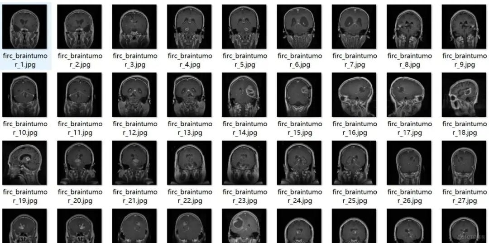
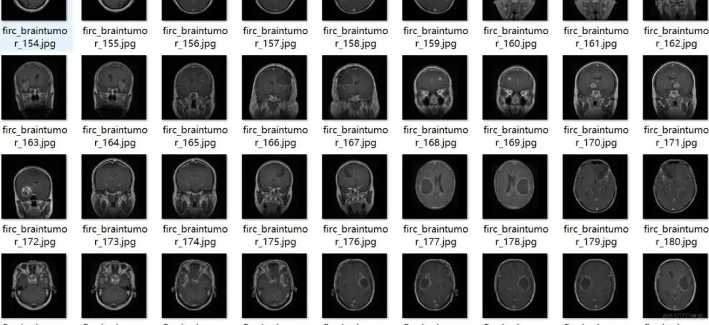
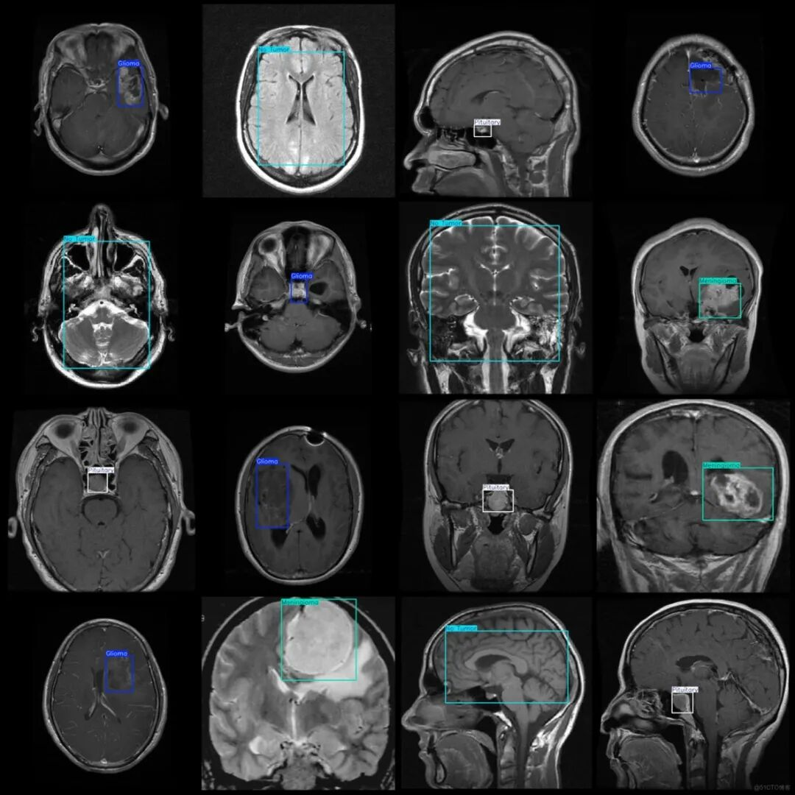
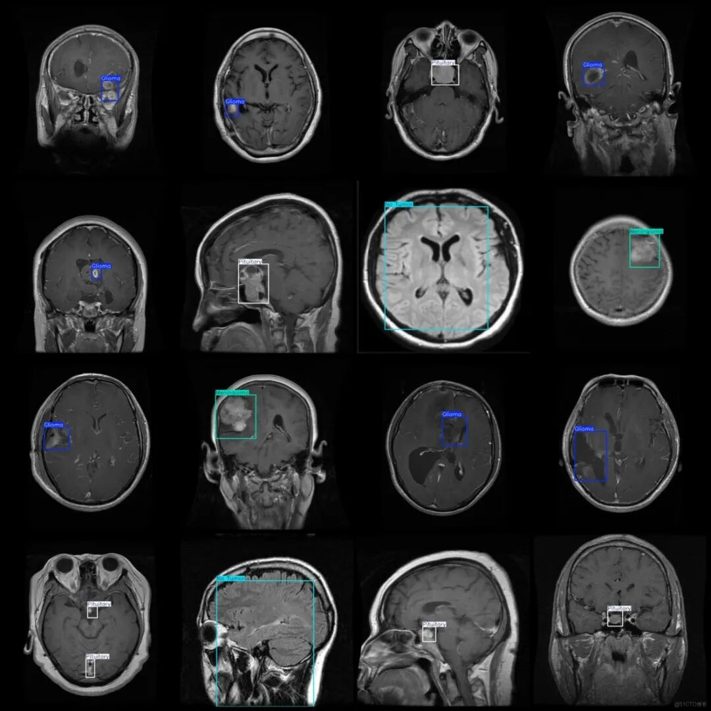

# Intelligent Medical Brain Tumor Detection Dataset VOC+YOLO format with 2243 images in 4 categories

Please note that about half of the dataset consists of enhanced images, primarily flipped ones.

Dataset format: Pascal VOC format + YOLO format (txt file without split path, only contains jpg images and corresponding VOC format xml files and yolo format txt files)

Number of images (number of jpg files): 2443

Number of annotations (number of xml files): 2443

Number of annotations (number of txt files): 2443

Label category count: 4

Label category names (note that the order of categories in the YOLO format does not correspond to this, but is based on the labels folder's classes.txt): ["Glioma", "Meningioma", "No Tumor", "Pituitary"]

Number of boxes labeled in each category:

Glioma (Glioblastoma) frame count = 830

Meningioma (Meningioma) Frame count = 547

No Tumor (No tumor) Frames = 483

Pituitary (Pituitary adenoma) Frame count = 612

Total frame count: 2472

Image resolution: 640x640

Using labelImg:

Annotation rules: Draw a rectangle around the category.

Important Notice: No

Special : This dataset does not guarantee the accuracy of the trained models or weight files.

Image Preview:

Annotation example:

## Payment

Here is a pay link on Stripe ( https://buy.stripe.com/3cs8yP7sY87d0vu9AB ). Please contact me lonlonago@foxmail.com after funding $89, and I will send you a complete data files , thank you!

